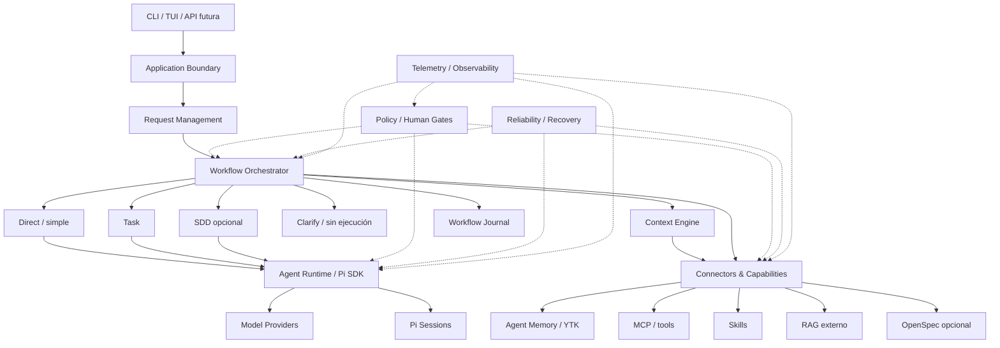

# Arquitectura objetivo — Your Gear

**Estado:** dirección de diseño acordada, 2026-11-24. No es descripción de código implementado ni especificación cerrada de interfaces. La [arquitectura vigente](architecture.md) conserva el estado real; el [roadmap](roadmap.md) determina los incrementos. Ver [ADR-005](decisions/ADR-005-local-agentic-platform.md).

## Mapa de responsabilidades



Las flechas representan responsabilidades e interacciones lógicas, no procesos de red, clases obligatorias ni permisos implícitos. Policy, Reliability y Telemetry son transversales, no etapas al final de una ejecución.

| Límite lógico | Responsabilidad | Base existente | Evolución |
| --- | --- | --- | --- |
| Presentation | Entrada, streaming, decisiones y UX | CLI, readline, trazas | TUI y sesión interactiva |
| Application Boundary | Invocar casos de uso sin depender del renderer | Coordinación en cli.ts | Extraer solo los casos necesarios |
| Request Management | Identidad, solicitud, estrategia, clarificación | Assessment y route review | Entrada unificada |
| Orchestrator | Estado y fases, agentes, gates, aceptación | Task Orchestrator | Direct/task/SDD coordinados |
| Agent Runtime | Sesiones, modelos, ejecución y eventos | Pi SDK 1.6.0 | Helpers y límites verificables |
| Context Engine | Selección, provenance, presupuesto y disclosure | Snapshots locales | Recall general y RAG externo |
| Connector Management | Configuración, disponibilidad, lifecycle, scopes | MCP y MemoryProvider | Gestión opt-in coherente |
| Governance | Permisos, políticas, decisiones humanas | policy/gate/approval | Reglas acotadas y evaluadas |
| Reliability | Errores, intentos, cancelación, reconciliación | Señal, timeouts y journal | Clasificación, presupuestos, recovery |
| Observability | Eventos, métricas, trazas, usage | stderr, eventos del journal | Contrato estructurado y exportación |

No crear una clase, directorio o servicio por cada fila. Es un mapa para orientar incrementos y evitar acoplamiento, no un inventario de abstracciones a implementar.

## Flujo objetivo de solicitud

1. Recibir prompt/request, identificar workspace y configuración efectiva. Una futura fuente externa (por ejemplo una US o issue) requiere un adaptador explícito; no asumir integración existente.
2. Evaluar semánticamente intención, incertidumbre, impacto y estrategia. Si hay incógnita bloqueante, aclarar. La recomendación no autoriza una acción.
3. Resolver capacidades requeridas y opcionales, seleccionar contexto y solicitar los consentimientos correspondientes.
4. Aplicar la estrategia: directa bajo policy; task con plan y gates; SDD con especificaciones y validación según el diseño de 3.E. Conservar modos explícitos de diagnóstico.
5. Ejecutar con control previo de efectos, límites y señal de cancelación. Emitir eventos y checkpoints en fronteras comprobables.
6. Verificar evidencia y solicitar aceptación humana cuando corresponda; devolver resultado explícito, incluso si es parcial, bloqueado o inconcluso.
7. Cerrar recursos, conservar historial mínimo y facilitar recuperación sin repetir efectos. Registrar consumo y duración observados.

## Conectores y configuración objetivo

Cada tipo mantiene un contrato acorde a sus operaciones; no forzar memoria, MCP, RAG y SDD dentro de una interfaz universal. Compartir únicamente lifecycle, diagnóstico o resolución de capacidades cuando el caso real lo justifique. Contratos versionados, configuración validada, scope explícito, credenciales fuera del repo y comportamiento definido ante fallos. No iniciar procesos de conectores deshabilitados ni cargar configuración ejecutable no confiable.

Ejemplo conceptual (NO es configuración aceptada por el CLI actual):

```json
{
  "connectors": {
    "memory": { "enabled": true, "provider": "ytk" },
    "rag": { "enabled": false },
    "mcp": {
      "enabled": true,
      "servers": ["azure-devops", "github", "playwright"]
    }
  },
  "workflows": {
    "classification": "automatic",
    "sdd": { "enabled": true, "provider": "openspec" }
  },
  "telemetry": { "enabled": true, "exporter": "local" }
}
```

Los servidores son ejemplos, no integraciones disponibles. Definir precedencias y política de confianza en Hito 5 antes de aceptar un nuevo esquema; no migrar configuración actual en esta decisión. Selección explícita y autorizaciones siguen vigentes. Conector opcional ausente: continuar solo si la tarea no depende de él. Capacidad imprescindible ausente: bloquear o acordar una alternativa, nunca afirmar éxito con evidencia faltante.

Memoria y RAG siguen siendo capacidades distintas. Los IDs de checkpoints se recuperan por referencia exacta; no buscar una tarea por similitud como autoridad. Pi SessionManager, Workflow Journal y memoria externa tienen responsabilidades diferentes (ADR-004). No acceder directamente a SQLite de YTK.

## Resiliencia por tipo de operación

| Situación | Política objetivo |
| --- | --- |
| Rate limit o fallo temporal de red | Backoff acotado con jitter, respetar Retry-After cuando exista; solo si no duplica efectos |
| JSON del modelo inválido | Regeneración limitada en operación sin efectos, con presupuesto |
| Auth/config inválida | Detener, diagnóstico accionable; sin fallback de facturación |
| Conector no disponible | Degradación explícita o bloqueo según necesidad |
| Snapshot/plan desactualizado | Releer, replanificar, invalidar aprobación afectada |
| Rechazo humano / cancelación | No reintentar ni solicitar aprobación repetidamente |
| Efecto incierto (write/shell/MCP/test/memory) | Inspección/reconciliación antes de cualquier repetición; idempotency key solo si contrato la soporta |
| Interrupción | Identificar estado y evidencia, confirmar proceso anterior detenido, nuevo intento y gates |
| Verificación fallida | Diagnóstico y propuesta de corrección acotada, no bucle ilimitado |

Definir límite de intentos, tiempo y consumo, propagación de cancelación y errores tipados con contexto mínimo. Distinguir fallo antes de efecto, resultado conocido y resultado incierto. No reintentar una llamada completa al modelo si puede haber emitido tools con efectos. Evitar duplicar retries de Pi/proveedor y harness. No prometer exactly-once ni rollback genérico; una recuperación es una nueva ejecución autorizada, no restauración de autoridad. Evaluar exclusión por workspace y coordinación de procesos cuando haya evidencia de concurrencia.

## Telemetría y observabilidad

Comenzar con eventos locales estructurados, correlacionados por requestId/workflowId/attemptId y agente/operación cuando corresponda. Registrar versión de esquema, tiempo, resultado, duración y categoría de error. Separar el journal de control/evidencia del flujo de telemetría; perder un evento de métrica no debe cambiar permisos ni marcar una tarea aceptada.

| Dimensión | Observaciones objetivo |
| --- | --- |
| Modelos | Proveedor, modelo, modo de auth, llamadas, latencia, input/output/cache tokens si informados |
| Agentes | Rol, invocaciones, tiempo, resultado y errores |
| Workflows | Ruta, fases, estado final, duración y vínculos de recuperación |
| Herramientas | Tipo/nombre autorizado, bloqueos, ejecución, fallos y duración |
| Conectores | Disponibilidad, latencia, errores y degradación |
| Memoria | Lecturas/escrituras, checkpoints y recuperación |
| Reliability | Intentos, retries, timeout, cancelación y resultados inciertos |
| Human gates | Tipo, decisión y duración de espera, no identidad personal innecesaria |

Los tokens medidos por proveedor/SDK se distinguen de estimaciones y de valores desconocidos; no convertir desconocido en cero ni sumar dos veces deltas y totales. No deducir coste API de tokens de suscripción. Si se calcula coste estimado de API, explicitar modelo, tarifas/versionado y supuestos; no afirmar facturación real.

Telemetría configurable, local por defecto en el diseño futuro; exportación externa solo opt-in. No incluir prompt, código, outputs, rutas sensibles, credenciales ni argumentos completos por defecto. Minimizacion, redacción, retención, límites de almacenamiento, eliminación y control de acceso deberán definirse. Error del exportador no debe conceder permisos ni impedir una tarea segura. Evaluar OpenTelemetry/OTLP y Grafana más adelante: no son dependencias decididas. Hito 8 consolida instrumentación que puede incorporarse antes.

## Presentación y distribución

CLI y TUI consumen los mismos casos de uso de aplicación y eventos; la UI no decide permisos ni coordina agentes de forma independiente. UX futura: setup/doctor, sesión interactiva, selección de modelos, conectores, progreso, aprobación con vista previa, cancelación y recuperación, panel de consumo. Mantener CLI utilizable en automatizaciones; no autoaprobar efectos por ausencia de TTY. Evaluar librería TUI con prototipo, no fijar una ahora. API/IDE son posibilidades futuras, no compromisos de roadmap.

Instalación npm publicada, releases y actualizaciones comprobables son objetivos, no estado actual. Mantener validación multiplataforma, documentación, versionado y rollback de actualizaciones, con criterios de aceptación de producción en Hito 10.

## Restricciones y estrategia de evolución

El estado actual sigue experimental. Implementar los Hitos 4–10 por cortes verticales pequeños tras 3.E, sin exigir un framework genérico ni mover todo el CLI de una vez. Cada incorporación nueva tiene tests, criterios de aceptación y evidencia; deuda de aceptación real permanece visible. Mantener las fronteras de seguridad de [security.md](security.md), ADR-001 a ADR-004 y la decisión de plataforma de ADR-005.
